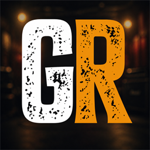

  

  <strong>Step into the lights. Become the headliner.</strong> 
  <a href="https://amiigosvr.github.io/guitar-reality-site/">Visit the Guitar Reality website</a>

---

Guitar Reality is a made-for-VR five-fret rhythm game where every note drives
the show. Nail riffs, build massive streaks, earn fans, unlock achievements,
and rise from neighborhood bars to spectacular festival stages.

## Bring your own songs

Rock the included original soundtrack or bring your own locally stored music.
Guitar Reality supports common Clone Hero and YARG song formats, including:

- Folders containing `notes.chart` or `notes.mid`
- Packed `.sng` songs
- `.ogg`, `.opus`, and `.wav` audio

Players are responsible for using music they own or are authorized to use.

## Play your way

- **PDP RIFFMASTER** in supported PS5 or PS4 mode*
- **Meta Quest Touch controllers** with classic or motion-strum controls
- **PS5, Xbox, and generic gamepads**
- **Physical keyboards**

A guitar controller is optional. Guided tutorials make every supported control
style easy to learn.

\*RIFFMASTER support requires a compatible USB to USB-C OTG adapter or dongle.

## Support

Need help with Guitar Reality? Contact AmiigosVR at
[amiigosvr@gmail.com](mailto:amiigosvr@gmail.com).

## Privacy

Read the [Guitar Reality Privacy Policy](https://amiigosvr.github.io/guitar-reality-site/privacy/) to learn what
information the app stores, how that information is used, and how it can be
deleted.

---

**Tune up. Take the stage. Make the crowd remember your name.**

Copyright &copy; 2026 AmiigosVR. All rights reserved.
